<!-- Galaxy Profile README Template
     Customize this file with your own info, then rename it to README.md
     in your GitHub profile repo (github.com/YOUR_USERNAME/YOUR_USERNAME).
     The images below live in assets/generated/ and are regenerated by the
     GitHub Actions workflow, or by running: python -m generator.main

     Each image comes in four files. The <picture> blocks let the visitor's
     browser pick one: the light or the dark theme, and a narrow layout on
     phones. If you prefer a single image, keep only the  line. -->

  <picture>
    <source media="(max-width: 600px) and (prefers-color-scheme: light)" srcset="./assets/generated/galaxy-header-mobile-light.svg">
    <source media="(max-width: 600px)" srcset="./assets/generated/galaxy-header-mobile.svg">
    <source media="(prefers-color-scheme: light)" srcset="./assets/generated/galaxy-header-light.svg">
    
  </picture>

 

  <picture>
    <source media="(max-width: 600px) and (prefers-color-scheme: light)" srcset="./assets/generated/stats-card-mobile-light.svg">
    <source media="(max-width: 600px)" srcset="./assets/generated/stats-card-mobile.svg">
    <source media="(prefers-color-scheme: light)" srcset="./assets/generated/stats-card-light.svg">
    
  </picture>

 

  <picture>
    <source media="(max-width: 600px) and (prefers-color-scheme: light)" srcset="./assets/generated/tech-stack-mobile-light.svg">
    <source media="(max-width: 600px)" srcset="./assets/generated/tech-stack-mobile.svg">
    <source media="(prefers-color-scheme: light)" srcset="./assets/generated/tech-stack-light.svg">
    
  </picture>

 

  <picture>
    <source media="(max-width: 600px) and (prefers-color-scheme: light)" srcset="./assets/generated/projects-constellation-mobile-light.svg">
    <source media="(max-width: 600px)" srcset="./assets/generated/projects-constellation-mobile.svg">
    <source media="(prefers-color-scheme: light)" srcset="./assets/generated/projects-constellation-light.svg">
    
  </picture>

 

<strong>More about me</strong>

 

  Hi, I am Hercules! I’m from Cotia, in the state of São Paulo. I’ve been passionate about technology since I was a child, 
studied Systems Development at ETEC Raposo Tavares, and am currently pursuing a degree in Computer Science at São Paulo Tech School. 
I’m an intern at CI&T, working in back-end development.

**Currently at** CI&T — São Paulo, SP

 

  
  

